<a href="https://github.com/minte-sys">
  <picture>
    <source media="(prefers-color-scheme: dark)" srcset="dark_mode.svg">
    
  </picture>
</a>

  <a href="https://github.com/minte-sys?tab=repositories"><picture><source media="(prefers-color-scheme: dark)" srcset="btn_projects_dark.svg"></picture></a>
  <a href="https://www.linkedin.com/in/mintesnot-mengesha-b09b0b288/"><picture><source media="(prefers-color-scheme: dark)" srcset="btn_linkedin_dark.svg"></picture></a>
  <a href="mailto:mintesnotmengesha55@gmail.com"><picture><source media="(prefers-color-scheme: dark)" srcset="btn_email_dark.svg"></picture></a>

  <a href="https://github.com/minte-sys/clinic-voice-agent"><picture><source media="(prefers-color-scheme: dark)" srcset="card_clinic_dark.svg"></picture></a>
  <a href="https://github.com/minte-sys/air-writing"><picture><source media="(prefers-color-scheme: dark)" srcset="card_airwriting_dark.svg"></picture></a>
  <a href="https://github.com/minte-sys/TriageBot"><picture><source media="(prefers-color-scheme: dark)" srcset="card_triagebot_dark.svg"></picture></a>

<picture>
  <source media="(prefers-color-scheme: dark)" srcset="https://raw.githubusercontent.com/minte-sys/minte-sys/output/pacman-contribution-graph-dark.svg">
  
</picture>
